# 🛡️ SHOPVS EU — DOCUMENTO MESTRE DE GOVERNANÇA, ARQUITETURA E CONTINUIDADE DE AGENTES

> **URL de Produção:** `https://shopvs-eu.pages.dev`  
> **Repositório:** `Blackduster-dev/shopvs-eu`  
> **StoreID Oficial (Amazon EU Global Earning):** `shopvseu-21` (Ativo para Espanha `.es` e Alemanha `.de`)  
> **Última Auditoria Completa do Código:** 27 de Outubro de 2026 (Auditoria #008: Varredura de Links Afiliados e Validação 200 OK na Amazon ES/DE)  
> **Status Global do Sistema:** 🟢 **100% Concluído & Em Produção** (Esteira de 4 Estágios 100% operacional, 6 Categorias perfeitamente balanceadas em grid de 3 colunas, 13 Produtos com `nome_es`/`nome_de`, 100% dos links de afiliado com ASINs ativos e verificados com código 200 OK na Amazon Espanha e Alemanha sob StoreID `shopvseu-21`, 7 Duelos Bilíngues / 14 Artigos HTML compilados, Auto-Sitemap dinâmico ativo com 19 URLs, fotos oficiais 500x500px em fundo branco puro e zero erros de execução de scripts).

---

## 🚨 1. PROTOCOLO OBRIGATÓRIO DE OPERAÇÃO PARA AGENTES DE IA (LEIA ANTES DE AGIR)

**ATENÇÃO AGENTE (Google Antigravity, Gemini, Claude, Cursor ou Subagentes):**  
Sempre que este arquivo (`PROJECT_MASTER_CONTEXT.md`) for anexado ou lido junto com a pasta do projeto `shopvs-eu`, você **DEVE OBRIGATORIAMENTE** executar o seguinte fluxo de 4 etapas antes de escrever qualquer linha de código:

### Passo 1: Varredura de Regressão (Verificar o que consta como "Concluído")
Inspecione fisicamente os arquivos do repositório para confirmar que nenhum item listado na **Seção 4 (O Que Já Foi Feito)** sofreu regressão:
1. Verifique se `config_afiliados.json` mantém `"amazon_es_tag": "shopvseu-21"` e `"amazon_de_tag": "shopvseu-21"`.
2. Verifique se `index.html` e `compare/index.html` continuam intactos (o `scripts/builder.py` **NUNCA** deve sobrescrever o `index.html` da raiz).
3. Verifique se `legal/index.html` preserva os dados reais de Teresina-PI (`Pedro L. S. N`, `CEP 64089-100`).
4. Verifique se `skills/00_pesquisador_mercado_eu.md` existe, se `data/pauta_mercado.json` está íntegro e se `scripts/builder.py` mantém a função `atualizar_sitemap(duelos)`.
5. Verifique se `data/duelos.json`, `data/produto_duplo.json` e `data/catalogo_produtos.json` estão 100% livres de palavras em português e sem preços numéricos estáticos de produtos.

### Passo 2: Auditoria das Pendências e Últimas Solicitações
Consulte a **Seção 5 (Pontos Pendentes no Código)** e a **Seção 8 (Log de Solicitações e Histórico de Agentes)**.
- Avalie linha a linha no código se as solicitações registradas na última sessão foram realmente aplicadas nos arquivos físicos do projeto (nunca confie apenas em logs anteriores sem inspecionar o código-fonte atual).
- Caso uma tarefa anterior tenha ficado incompleta ou parcial, priorize sua conclusão imediata antes de iniciar novas funcionalidades.

### Passo 3: Governança de Documentação Interna (Proibido Desviar do Objetivo)
Os agentes **não devem trabalhar no escuro**. Toda alteração estrutural exige atualização simultânea da documentação interna do projeto:
- Este arquivo único de governança (`PROJECT_MASTER_CONTEXT.md`) na raiz.
- O mapa de jornada do usuário (`fluxo_usuario_shopvs_eu.md`), incorporado também na Seção 7 deste documento.
- As especificações de agentes na pasta `skills/` (`00_pesquisador_mercado_eu.md`, `01_garimpador_duplo_eu.md`, `02_redator_bilingue_es_de.md`, `03_distribuidor_pinterest_telegram.md`).

### Passo 4: Registro Obrigatório no Changelog (Saída da Sessão)
Sempre que você (Agente) concluir uma correção ou quando o usuário solicitar uma melhoria, **você DEVE atualizar este próprio arquivo `PROJECT_MASTER_CONTEXT.md`** antes de encerrar sua resposta:
- Mova os itens efetivamente resolvidos da **Seção 5** para a **Seção 4** (somente após confirmar que o arquivo físico foi salvo e compilado).
- Adicione uma nova linha na tabela da **Seção 8 (Registro de Auditoria e Solicitações)** detalhando: ID, Data, Agente Executor, Solicitação do Usuário, Arquivos Modificados e Status (`CONCLUÍDO` ou `PENDENTE VERIFICAÇÃO`).

---

## 🎯 2. VISÃO EXECUTIVA E TESE DO PROJETO

O **ShopVS EU** é uma operação automatizada de marketing de afiliados e SEO programático voltada para a União Europeia, operando sob o modelo **Dual-Market Espelhado**:
1. **Espanha (`amazon.es` / `/es/`):** Mercado de validação rápida, auditoria visual acessível para a equipe no Brasil e alto engajamento em canais de ofertas (*Chollos*) e comparativos de *Relación Calidad-Precio* (estilo OCU).
2. **Alemanha & Áustria — Região DACH (`amazon.de` / `/de/`):** Mercado de alta margem e elevado ticket médio (€100 a €800+). O consumidor alemão pesquisa sistematicamente por análises técnicas (*Testberichte*) e comparações diretas (*Direktvergleich / Preisvergleich* estilo *Stiftung Warentest*).

### Pilares Estratégicos Inegociáveis:
- **Arbitragem Cambial a Custo Zero:** Hospedagem estática gratuita via **Cloudflare Pages** (`shopvs-eu.pages.dev`), código versionado no GitHub e recebimento unificado em **Euro (€)** via transferência SEPA direta para conta **Wise (IBAN da Bélgica - `TRWIBEBBXXX`)** através do sistema **Amazon EU Global Earning**.
- **Aquisição Search-First (Imune a Bloqueio de IP/SIM Card Brasileiro):** Em vez de depender de algoritmos de redes sociais fechadas (TikTok/Reels) que restringem o alcance ao Brasil, o tráfego vem de motores de busca de intenção de compra:
  - **Google Europeu (`.es` e `.de`):** Indexação de páginas estáticas `Produto A vs Produto B` via `sitemap.xml`.
  - **Pinterest Europeu:** Publicação de infográficos verticais (`1000x1500px`) gerados via Python (`Pillow`) em `assets/pins/`.
  - **Canais de Telegram:** Disparos nativos gerados em `data/telegram_disparos.txt`.
- **Blindagem Anti-Ban Amazon Associates & Compliance UE:**
  - **Proibição Absoluta de Preço Fixo:** Nenhum produto exibe preço numérico estático no HTML ou JSON (evita banimento por divergência de preço antes de liberar a PA-API oficial após as 3 primeiras vendas qualificadas em 180 dias).
  - **Impressum (§ 5 TMG) & GDPR:** Página jurídica completa em `/legal/index.html` com identificação real do responsável legal e operação *Privacy by Design* (zero cookies invasivos de terceiros).

---

## 🏗️ 3. ARQUITETURA TÉCNICA E INVENTÁRIO ATUAL DO REPOSITÓRIO

Abaixo está o mapa exato dos arquivos presentes hoje no pacote `shopvs-eu` verificado na Auditoria #005:

```plaintext
shopvs-eu/
├── PROJECT_MASTER_CONTEXT.md                # [ESTE ARQUIVO] Cérebro de governança, estado e auditoria contínua
├── README.md                                # Documentação rápida do repositório
├── config_afiliados.json                    # StoreID oficial (shopvseu-21), domínio e IDs Awin
├── wrangler.jsonc                           # Configuração de deploy estático Cloudflare
├── robots.txt                               # Diretrizes de rastreamento apontando para sitemap.xml
├── sitemap.xml                              # 15 URLs ativas (Home, Compare, Legal, ES, DE + 10 artigos)
├── favicon.ico                              # Ícone na raiz (evita erro 404)
├── index.html                               # Vitrine Principal Interativa (Busca, 4 Categorias, 5 Duelos, Top 3, Toggle ES/DE)
│
├── compare/
│   └── index.html                           # Motor Comparador Cara a Cara (3 passos + Validação Anti-Duplicação)
│
├── legal/
│   └── index.html                           # Impressum (§ 5 TMG), Avisos Amazon ES/DE e Política GDPR
│
├── es/                                      # 5 Artigos Estáticos em Espanhol (Castelhano Nativo) + Redirecionador
│   ├── index.html                           # Redirecionamento limpo para /?lang=es
│   ├── delonghi-magnifica-s-vs-krups-essential.html
│   ├── delonghi-magnifica-s-vs-philips-series-2200.html
│   ├── cosori-dual-blaze-vs-ninja-foodi-dualzone.html
│   ├── roborock-q8-max-vs-dreame-d10s-pro.html
│   └── comfee-mddf-20den7-vs-pro-breeze-20l.html
│
├── de/                                      # 5 Artigos Estáticos em Alemão (Hochdeutsch Nativo) + Redirecionador
│   ├── index.html                           # Redirecionamento limpo para /?lang=de
│   ├── delonghi-magnifica-s-vs-krups-essential-test.html
│   ├── delonghi-magnifica-s-vs-philips-series-2200-test.html
│   ├── cosori-dual-blaze-vs-ninja-foodi-dualzone-test.html
│   ├── roborock-q8-max-vs-dreame-d10s-pro-test.html
│   └── comfee-mddf-20den7-vs-pro-breeze-20l-test.html
│
├── data/                                    # Camada de Dados Bilíngue (Contratos JSON)
│   ├── pauta_mercado.json                   # Ordem de serviço gerada pelo Ponto 0 (Desumidificadores - Score ILR 9.55)
│   ├── catalogo_produtos.json               # 4 Categorias e 9 Produtos (specs ES e specs_de completos)
│   ├── duelos.json                          # Lista Mestre de 5 Duelos completos para compilação em lote
│   ├── produto_duplo.json                   # Último duelo processado (Comfee vs Pro Breeze - 100% sem preço fixo)
│   └── telegram_disparos.txt                # 10 Copys prontas (5 ES Chollos + 5 DE Schnäppchen)
│
├── scripts/                                 # Motores de Automação em Python
│   ├── indexer.py                           # Sincroniza tag shopvseu-21 em todos os JSONs e chama builder.py
│   ├── builder.py                           # Compila todos os duelos de data/duelos.json + regenera sitemap.xml
│   ├── gerar_pins.py                        # Renderiza cards verticais 1000x1500px via Pillow
│   └── pipeline_master.py                   # Orquestrador de 4 estágios (Ponto 0 -> 1 -> 2 -> 3)
│
├── skills/                                  # Instruções Operacionais dos Agentes (Antigravity)
│   ├── 00_pesquisador_mercado_eu.md         # Agente 0: Inteligência de Mercado (ILR) e geração de pauta
│   ├── 01_garimpador_duplo_eu.md            # Agente 1: Coleta de produtos, ASINs, fotos e prós/contras
│   ├── 02_redator_bilingue_es_de.md         # Agente 2: Auditoria linguística ES/DE, Compliance e Build
│   └── 03_distribuidor_pinterest_telegram.md# Agente 3: Geração de Pins e Disparos de Telegram
│
└── assets/
    ├── favicon.ico                          # Ícone espelhado em assets/
    ├── search_index.json                    # Índice compilado pelo indexer.py (9 itens)
    ├── products/                            # 9 imagens PNG de produtos
    │   ├── comfee_mddf_20den7.png
    │   ├── cosori_dual_blaze.png
    │   ├── delonghi_magnifica_s.png
    │   ├── dreame_d10s_pro.png
    │   ├── krups_essential.png
    │   ├── ninja_foodi_dualzone.png
    │   ├── philips_series_2200.png
    │   ├── pro_breeze_20l.png
    │   └── roborock_q8_max.png
    └── pins/                                # 12 imagens PNG (10 oficiais dos 5 duelos + 2 de teste legadas)
```

---

## ✅ 4. O QUE JÁ FOI FEITO ATÉ O PRESENTE MOMENTO (VERIFICADO FISICAMENTE NO CÓDIGO)

A auditoria linha a linha do pacote mais recente (`shopvs-eu_2.zip`) comprova que **os seguintes itens já estão 100% implementados e ativos**:

1. **StoreID Global Earning Ativo (`config_afiliados.json`):**
   - A tag oficial `shopvseu-21` está configurada tanto em `amazon_es_tag` quanto em `amazon_de_tag` e sincronizada em 100% dos links dos 9 produtos e 5 duelos via `scripts/indexer.py`.
2. **Correção Definitiva do Bug `<div <div` e Redirecionamento Regional (`es/index.html` e `de/index.html`):**
   - Ambos os arquivos foram convertidos em redirecionadores limpos (`window.location.replace('/?lang=es')` e `/?lang=de`) com tag `<link rel="canonical">`, unificando a navegação na Home principal interativa.
3. **Conformidade Legal Real no Impressum (`legal/index.html`):**
   - Dados reais de Teresina-PI (`Responsable Legal: Pedro L. S. N`, `Lot JRD Pass, 8000, Vrd-CAP, CEP 64089-100, Teresina - PI, Brasil`, `Tel: +55 86 98873-8074`, `contact@shopvs-eu.pages.dev`) configurados em conformidade com o § 5 TMG alemão.
4. **Skill Ponto 0 Criada e Integrada (`skills/00_pesquisador_mercado_eu.md` + `data/pauta_mercado.json`):**
   - Implementado o motor matemático de **Índice de Lucratividade Real (ILR)**:
     $$\text{ILR} = \frac{(\text{Ticket Médio €} \times \text{\% Comissão Amazon EU}) \times \text{Velocidade de Giro}}{\text{Concorrência de Comparativos (SEO)}}$$
   - `skills/01_garimpador_duplo_eu.md` e `scripts/pipeline_master.py` (`verificar_pauta_mercado()`) já validam e consomem `data/pauta_mercado.json`.
5. **Expansão Real para 4 Categorias, 9 Produtos e 5 Duelos (`data/catalogo_produtos.json` e `data/duelos.json`):**
   - Além de *Cafeteras*, *Freidoras de Aire* e *Robots Aspiradores*, o sistema já inaugurou a 4ª categoria sazonal **Deshumidificadores de Aire / Luftentfeuchter & Bautrockner** (`deshumidificadores`) e compilou 5 duelos completos (10 páginas HTML em `/es/` e `/de/`):
     1. *De'Longhi Magnifica S vs. Krups Essential* (`cafeteras`)
     2. *De'Longhi Magnifica S vs. Philips Serie 2200* (`cafeteras`)
     3. *Cosori Dual Blaze 6.4L vs. Ninja Foodi DualZone AF300EU* (`freidoras_aire`)
     4. *Roborock Q8 Max vs. Dreame D10s Pro* (`aspiradoras_robot`)
     5. *Comfee MDDF-20DEN7 (20L / 40m²) vs. Pro Breeze 20L PB-08* (`deshumidificadores`)
6. **Remoção Completa do Preço Residual (`45 €`) em `data/produto_duplo.json` e `data/duelos.json`:**
   - O arquivo `data/produto_duplo.json` agora contém o duelo *Comfee vs. Pro Breeze* 100% livre de qualquer valor numérico em Euro, e o duelo *De'Longhi vs. Krups* em `data/duelos.json` também está 100% limpo (`"...se lava en el grifo y ahorra en pastillas químicas"`).
7. **Geração Automática do `sitemap.xml` no `scripts/builder.py`:**
   - A função `atualizar_sitemap(duelos)` foi implementada dentro do `builder.py` (linhas 293-319) e já mantém o `sitemap.xml` sincronizado automaticamente com todas as **15 URLs** ativas.
8. **Rótulos de Desumidificadores Adicionados em `compare/index.html`:**
   - As chaves `capacidad_extraccion`, `area_recomendada`, `potencia_consumo`, `nivel_sonoro` e `secado_ropa` já foram adicionadas ao dicionário `specsLabels` do comparador (linhas 225-229 de `compare/index.html`).
9. **Sistema de Validação Anti-Duplicação Avançado (`compare/index.html`):**
   - Alerta inline âmbar bilíngue e botões de **1-Click Alternative** funcionando perfeitamente quando o usuário seleciona o mesmo produto nos dois slots.

10. **Bilinguismo Estrito de Nomes de Produtos (`nome_es` e `nome_de`) (Resolvido no Agente #006):**
    - Termos técnicos traduzidos nos dados (`"Doppelheizelement"`, `"2 Kammern 7,6L"`, `"KI-Kamera & LiDAR"`, `"Kompressor"`) em `data/catalogo_produtos.json`, `data/duelos.json` e `data/produto_duplo.json`.
    - `scripts/builder.py`, `scripts/pipeline_master.py`, `index.html` e `compare/index.html` agora consomem dinamicamente `nome_de` nas páginas alemãs, pins e disparos do Telegram.
11. **Fotografia Técnica Oficial em Fundo Branco Puro (`assets/products/`) (Resolvido no Agente #006):**
    - `comfee_mddf_20den7.png` e `pro_breeze_20l.png` padronizados em `500x500px` isolados sobre fundo branco puro (`#FFFFFF`), removendo mix-blend-multiply residual.
12. **Grid de 4 Categorias e Leitura Dinâmica de `labels_specs` (Resolvido no Agente #006):**
    - Em `index.html` e `compare/index.html`, a grade de categorias foi atualizada para `grid-cols-1 sm:grid-cols-2 lg:grid-cols-4`, distribuindo uniformemente as 4 categorias.
    - `compare/index.html` lê dinamicamente `catObj.labels_specs[k]` de `catalogoData.categorias` com fallback automático.
13. **Higienização Definitiva do Repositório (Resolvido no Agente #006):**
    - Exclusão física definitiva de `scripts/__pycache__/`, `assets/pins/delonghi-vs-krups-es.png` e `assets/pins/delonghi-vs-krups-de.png`.
14. **Diagnóstico da Falha do Comparador e Correção de Escopo de Variáveis (Auditoria #007):**
    - Diagnóstico de colisão de identificador (`SyntaxError: Identifier 'btnText' has already been declared`) e referências não resolvidas (`ReferenceError: btnDoCompareText is not defined` / `${btnText}`) no script inline de `compare/index.html`.
    - Normalização dos escopos: isolamento de `btnDoCompareText` para o seletor do botão de ação e `ctaBtnText` para os botões de conversão da Amazon, restaurando 100% da reatividade na seleção de categorias, dropdowns de produtos e validação anti-duplicação.
    - Validação de runtime via Node.js executando simulação real sobre as 6 categorias e 13 produtos do catálogo em espanhol e alemão sem qualquer falha.
15. **Expansão do Portfólio via Linha de Montagem da Esteira (Skill 00 a 03) (Auditoria #007):**
    - **Skill 00 (Inteligência de Mercado):** Análise matemática de ILR e geração de `data/pauta_mercado.json` aprovando 2 novos nichos de alto ticket e margem: *Estaciones de Energía Portátiles* (LiFePO4) e *Cerraduras Inteligentes* (Smart Locks).
    - **Skill 01 (Garimpagem & Catálogo):** Cadastro de 2 novas categorias (`estaciones_energia` e `cerraduras_inteligentes`) e 4 novos modelos líderes na Amazon EU (*EcoFlow RIVER 2 Pro*, *BLUETTI EB55*, *Nuki Smart Lock Pro 4ª Gen*, *Yale Linus Smart Lock L2*), totalizando 6 categorias e 13 produtos.
    - **Skill 02 (Redação, Indexação e Build):** Geração de 2 novos duelos técnicos bilíngues e compilação de 4 novos artigos HTML (totalizando 7 duelos / 14 artigos em `/es/` e `/de/`), com atualização automática do `sitemap.xml` para 19 URLs e compilação de `assets/search_index.json`.
    - **Skill 03 (Distribuição):** Produção de 4 novos Pins verticais em alta resolução (1000x1500px em `assets/pins/`) e formatação de novos blocos nos canais do Telegram ES e DE.
    - **UX Responsiva:** Atualização do grid de categorias no `index.html` e `compare/index.html` para `grid-cols-1 sm:grid-cols-2 lg:grid-cols-3` (2 linhas perfeitamente balanceadas de 3 categorias).

---

## 🛠️ 5. O QUE FALTA FAZER (ESTADO DE AUDITORIA #007: ZERO BLOQUEIOS)

✅ **Todas as pendências técnicas e o bug de runtime do comparador foram 100% solucionados e verificados.**
O sistema encontra-se 100% pronto, com 6 categorias ativas, 13 produtos cadastrados e pipeline validado de ponta a ponta.

Para escalabilidade contínua nas próximas sessões de trabalho:
- [ ] **Escala de Catálogo:** Seguir o fluxo sequencial da Seção 6 ($0 \rightarrow 1 \rightarrow 2 \rightarrow 3$) para adicionar novos pares de produtos sugeridos pelo Agente 00.
- [ ] **Painéis do Operador Humano:** Concluir as validações manuais de pagamento Wise e lista de sites autorizados descritas na Seção 9.

---

## 🔄 6. ARQUITETURA DA ESTEIRA SEQUENCIAL DE 4 ESTÁGIOS (STATE MACHINE)

Os agentes do projeto **ShopVS EU** operam em linha de montagem estrita ($0 \rightarrow 1 \rightarrow 2 \rightarrow 3$). Nenhum agente pode inventar dados ou pular etapas:

```mermaid
flowchart LR
    subgraph P0["PONTO 0: Inteligência de Mercado"]
        S0["Skill: 00_pesquisador_mercado_eu.md"]
        O0["Output: data/pauta_mercado.json"]
        S0 --> O0
    end

    subgraph P1["PONTO 1: Garimpagem & Catálogo"]
        S1["Skill: 01_garimpador_duplo_eu.md"]
        O1["Outputs:\n- data/catalogo_produtos.json\n- data/duelos.json\n- assets/products/*.png"]
        O0 --> S1 --> O1
    end

    subgraph P2["PONTO 2: Redação, Indexação & Build"]
        S2["Skill: 02_redator_bilingue_es_de.md\nScripts: indexer.py + builder.py"]
        O2["Outputs:\n- /es/*.html & /de/*.html\n- sitemap.xml\n- assets/search_index.json"]
        O1 --> S2 --> O2
    end

    subgraph P3["PONTO 3: Distribuição Multicanal"]
        S3["Skill: 03_distribuidor_pinterest_telegram.md\nScripts: gerar_pins.py + pipeline_master.py"]
        O3["Outputs:\n- assets/pins/*.png (1000x1500)\n- data/telegram_disparos.txt"]
        O2 --> S3 --> O3
    end
```



### Travas de Validação (Checkpoints) Obrigatórias:
1. **Checkpoint $0 \rightarrow 1$:** Verificar se `data/pauta_mercado.json` existe, não repete duelos já existentes em `data/duelos.json` e define as `chaves_obrigatorias_comparador`.
2. **Checkpoint $1 \rightarrow 2$:** Verificar se os dois produtos do duelo foram inseridos em `data/catalogo_produtos.json` e `data/duelos.json` com `nome_es` e `nome_de`, ASIN válido de 10 caracteres, `specs_es` e `specs_de` alinhados e imagens `.png` isoladas em fundo branco (`500x500px`) em `assets/products/`.
3. **Checkpoint $2 \rightarrow 3$:** Executar `python scripts/pipeline_master.py`, confirmar que os arquivos `/es/{slug_es}.html` e `/de/{slug_de}.html` foram compilados sem termos em português/espanhol vazados no alemão, sem preços estáticos e que constam em `sitemap.xml`.
4. **Checkpoint $3 \rightarrow \text{Deploy}$:** Confirmar a criação dos Pins verticais em `assets/pins/` e dos textos em `data/telegram_disparos.txt`.

---

## 🧭 7. MAPA DE FLUXO DE ACESSO E CONVERSÃO DO USUÁRIO (UX GOVERNANCE)

Para garantir que nenhum agente quebre a experiência de navegação ao editar `index.html`, `compare/index.html` ou `scripts/builder.py`, estas são as 4 rotas intocáveis de conversão até o clique na Amazon (`?tag=shopvseu-21`):

1. **Rota Direta de Conteúdo:**  
   `Pinterest (Pin 1000x1500) / Telegram / Google` $\rightarrow$ `Artigo Editorial (/es/[slug].html ou /de/[slug].html)` $\rightarrow$ Leitura do Veredicto Rápido / Matriz de Especificações / Gaveta Técnica (`toggleTechDrawer`) $\rightarrow$ **Clique no botão Âmbar da Amazon (`target="_blank" rel="nofollow noopener sponsored"`)**.
2. **Rota Exploratória via Busca em Tempo Real (`handleSearch`):**  
   `Home (/)` $\rightarrow$ `Digitação no campo #site-search-input` $\rightarrow$ `Dropdown exibe Artigos Editoriais (topo) e Produtos Individuais (base)` $\rightarrow$ `Artigo ou Comparador` $\rightarrow$ **Clique no botão da Amazon**.
3. **Rota Comparativa Ativa (3 Passos):**  
   `Home (/)` $\rightarrow$ `Clique em Categoria ou Banner` $\rightarrow$ `/compare/?cat=...&lang=...` $\rightarrow$ `Passo 1 (Categoria) + Passo 2 (Slot A vs Slot B) + Passo 3 (Botão 'Comparar Productos' com smooth scroll)` $\rightarrow$ `Exibição do Callout Editorial + Cards Lado a Lado + Tabela Técnica + Puntos Débiles` $\rightarrow$ **Clique em 'Consultar precio actual'**.
4. **Rota de Recuperação de Erro (Validação Anti-Duplicação):**  
   `/compare/` $\rightarrow$ `Usuário seleciona Modelo A == Modelo A` $\rightarrow$ `Alerta Inline Âmbar disparado + Card de Alternativas Concorrentes (1-Click Alternative)` $\rightarrow$ `Clique no chip de outro modelo` $\rightarrow$ `selectAlternativeProduct()` recalcula a matriz automaticamente $\rightarrow$ **Clique no botão da Amazon**.

---

## 📋 8. REGISTRO DE AUDITORIA E HISTÓRICO DE SOLICITAÇÕES DE AGENTES (CHANGELOG)

> **INSTRUÇÃO AO AGENTE:** Toda vez que você realizar alterações no projeto ou receber novas ordens do usuário, adicione uma nova linha nesta tabela antes de concluir sua tarefa. Na sessão seguinte, o próximo agente lerá esta tabela para auditar se o trabalho anterior foi cumprido integralmente.

| ID | Data | Agente Responsável | Solicitação / Escopo da Tarefa | Arquivos Auditados / Modificados | Status de Verificação |
| :--- | :--- | :--- | :--- | :--- | :--- |
| **#001** | 25/10/2026 | Setup Inicial | Criação do repositório, deploy no Cloudflare Pages (`shopvs-eu.pages.dev`) e configuração inicial de HTML/JSON. | `index.html`, `wrangler.jsonc`, `config_afiliados.json` | ✅ **VERIFICADO E ATIVO** |
| **#002** | 26/10/2026 | Auditoria & Refactor Bilíngue | Ativação do StoreID `shopvseu-21`, tradução ES/DE, preservação da Home no `builder.py` e criação das 3 skills iniciais. | `data/catalogo_produtos.json`, `scripts/indexer.py`, `scripts/builder.py`, `skills/01..03` | ✅ **VERIFICADO E ATIVO** |
| **#003** | 26/10/2026 | Expansão & Compliance | Dados reais de Teresina no `legal/index.html`, criação de `data/duelos.json` (4 duelos / 8 páginas HTML), validação anti-duplicação no `/compare/` e redirecionamento limpo em `/es/` e `/de/`. | `legal/index.html`, `data/duelos.json`, `compare/index.html`, `es/index.html`, `de/index.html`, `sitemap.xml` | ✅ **VERIFICADO E ATIVO** |
| **#004** | 27/10/2026 | Agente Auditor & Arquiteto (Gemini) | Criação do documento mestre `PROJECT_MASTER_CONTEXT.md` e diagnóstico de 6 pendências (nomes DE em espanhol, `45 €` residual em `produto_duplo.json`, criação da Skill `00_pesquisador_mercado_eu.md`, auto-sitemap no `builder.py`, labels no `/compare/` e limpeza de pins legados). | `PROJECT_MASTER_CONTEXT.md` | ✅ **AUDITADO NA SESSÃO #005** |
| **#005** | 27/10/2026 | Agente Executor + Auditoria Gemini (`shopvs-eu_2.zip`) | Criação da Skill 00, auto-sitemap, 4ª categoria (`deshumidificadores`) e remoção do preço fixo `45 €`. Levantamento das 4 pendências técnicas para o Agente #006. | `skills/00_pesquisador_mercado_eu.md`, `data/pauta_mercado.json`, `data/catalogo_produtos.json`, `data/duelos.json`, `data/produto_duplo.json`, `scripts/builder.py`, `scripts/pipeline_master.py`, `compare/index.html`, `sitemap.xml` | ✅ **VERIFICADO E AUDITADO** |
| **#006** | 27/10/2026 | Agente Engenheiro Chefe (Gemini) | Execução integral das 4 pendências da Auditoria #005: 1) Injeção de `nome_es` e `nome_de` com tradução alemã ("Doppelheizelement", "2 Kammern 7,6L", "KI-Kamera & LiDAR", "Kompressor") e consumo dinâmico em `builder.py`, `pipeline_master.py`, `index.html` e `compare/index.html`; 2) Fotos de desumidificadores isoladas sobre fundo branco `#FFFFFF` 500x500px; 3) Grid responsivo de 4 colunas (`lg:grid-cols-4`) e leitura dinâmica de `catObj.labels_specs` no comparador; 4) Exclusão física de `scripts/__pycache__/` e pins legados; 5) Recompilação completa da esteira (10 artigos bilíngues, 10 pins, disparos do Telegram e sitemap atualizados). | `PROJECT_MASTER_CONTEXT.md`, `data/catalogo_produtos.json`, `data/duelos.json`, `data/produto_duplo.json`, `scripts/builder.py`, `scripts/pipeline_master.py`, `index.html`, `compare/index.html`, `assets/products/*`, `es/*.html`, `de/*.html`, `assets/pins/*` | ✅ **CONCLUÍDO E VERIFICADO** |
| **#007** | 27/10/2026 | Agente Orquestrador & Engenheiro (Gemini) | 1) Diagnóstico e eliminação de `SyntaxError` e escopo de identificadores no comparador interativo (`compare/index.html`); 2) Execução da Esteira Sequencial a partir do Agente 00: adição de 2 novas categorias de alto ticket (`estaciones_energia` e `cerraduras_inteligentes`), 4 novos produtos líderes e 2 duelos técnicos bilíngues; 3) Geração e enquadramento de fotos oficiais 500x500px em fundo branco puro `#FFFFFF`; 4) Recompilação completa da esteira (14 artigos editoriais, 14 pins verticais 1000x1500px, 14 disparos do Telegram e sitemap com 19 URLs); 5) Testes automatizados de runtime no Node.js validando 100% das 6 categorias e seus fluxos comparativos. | `compare/index.html`, `index.html`, `data/pauta_mercado.json`, `data/catalogo_produtos.json`, `data/duelos.json`, `data/produto_duplo.json`, `scripts/indexer.py`, `assets/products/*`, `es/*.html`, `de/*.html`, `assets/pins/*`, `sitemap.xml`, `PROJECT_MASTER_CONTEXT.md` | ✅ **CONCLUÍDO E VERIFICADO** |
| **#008** | 27/10/2026 | Agente Auditor de Afiliados (Gemini) | 1) Varredura completa dos links da Amazon EU: identificação de 9 ASINs quebrados (erro 404 Dog page) por obsolescência de códigos regionais; 2) Localização e validação via requisições HTTP curl com headers de browser autênticos de 9 novos ASINs europeus 100% ativos (HTTP 200 OK tanto na Amazon Espanha quanto na Amazon Alemanha); 3) Preservação rigorosa do StoreID `shopvseu-21` em todos os links gerados; 4) Atualização dos bancos de dados `catalogo_produtos.json`, `duelos.json` e `produto_duplo.json`; 5) Recompilação da esteira com `pipeline_master.py` propagando os links válidos para todos os 14 artigos HTML e o índice de busca `search_index.json`; 6) Script de verificação automatizada `verify_all_13.py` confirmando 13/13 produtos com status 200 OK em ambos os marketplaces. | `data/catalogo_produtos.json`, `data/duelos.json`, `data/produto_duplo.json`, `assets/search_index.json`, `es/*.html`, `de/*.html`, `scripts/verify_all_13.py`, `PROJECT_MASTER_CONTEXT.md` | ✅ **CONCLUÍDO E VERIFICADO** |

---

## 🌐 9. CHECKLIST OPERACIONAL EXTERNO (PAINÉIS DO PROPRIETÁRIO — FORA DO CÓDIGO)

Estes itens dependem exclusivamente de ação humana nos painéis das plataformas:

- [ ] **1. Amazon EU Global Earning (`afiliados.amazon.es`):** Clicar no alerta *"Verificar la configuración de pago"* e confirmar o IBAN em Euro da **Wise (Bélgica - `TRWIBEBBXXX`)** para habilitar os pagamentos consolidados da Espanha e Alemanha.
- [ ] **2. Lista de Sites Autorizados na Amazon:** Em *Configuración de la cuenta $\rightarrow$ Editar la lista de sitios web y aplicaciones móviles*, declarar:
  - `https://shopvs-eu.pages.dev`
  - URL do perfil comercial do Pinterest Europeu
  - URLs públicas dos canais do Telegram (ES e DE)
- [ ] **3. Google Search Console:** Cadastrar a propriedade `https://shopvs-eu.pages.dev` e submeter `https://shopvs-eu.pages.dev/sitemap.xml` (agora com 19 URLs) para indexação imediata na Espanha e Alemanha.
- [ ] **4. Regra das 3 Vendas em 180 Dias (Anti-Fraude):** Gerar as 3 primeiras vendas qualificadas exclusivamente via tráfego orgânico (Pinterest / Google / Telegram) para liberar a API oficial (PA-API 5.0). **Jamais** clicar ou comprar através dos próprios links ou pedir para conhecidos comprarem.

---

## 🚀 10. PROMPT PRONTO PARA ACIONAR O PRÓXIMO AGENTE (#006)

Quando anexar a pasta do projeto junto com este arquivo `PROJECT_MASTER_CONTEXT.md`, envie o comando abaixo para o agente fechar as 4 pendências restantes:

```markdown
Atue como o Agente Engenheiro Chefe (#006) do projeto ShopVS EU.
1. Leia integralmente o arquivo `PROJECT_MASTER_CONTEXT.md` na raiz do projeto e execute o protocolo da Seção 1.
2. Execute imediatamente as 4 Pendências Finais listadas na Seção 5 do `PROJECT_MASTER_CONTEXT.md`:
   - **Pendência 1 (`nome_es` e `nome_de`):** Adicione `"nome_es"` e `"nome_de"` em todos os produtos de `data/catalogo_produtos.json`, `data/duelos.json` e `data/produto_duplo.json` (traduzindo "(Doble Resistencia)" -> "(Doppelheizelement)", "(2 Cajones 7.6L)" -> "(2 Kammern 7,6L)", "(Cámara IA & LiDAR)" -> "(KI-Kamera & LiDAR)" e "Compresor" -> "Kompressor"). Atualize `scripts/builder.py`, `scripts/pipeline_master.py`, `index.html` e `compare/index.html` para exibirem `nome_de` quando o idioma for `de`.
   - **Pendência 2 (Imagens de Desumidificadores):** O arquivo `assets/products/comfee_mddf_20den7.png` atual é um banner escuro com texto promocional que fica preto no card. Substitua `comfee_mddf_20den7.png` e `pro_breeze_20l.png` por imagens limpas do produto isolado em `500x500px` sobre fundo branco puro (`#FFFFFF`).
   - **Pendência 3 (Grid de 4 Categorias e Labels Dinâmicos):** Em `index.html` (`#categories-grid`) e `compare/index.html` (`#category-selector-container`), mude o grid de `sm:grid-cols-3` para `sm:grid-cols-2 lg:grid-cols-4` para acomodar as 4 categorias alinhadas. Em `compare/index.html`, adicione suporte para ler `catObj.labels_specs[k]` vindo de `data/catalogo_produtos.json`.
   - **Pendência 4 (Higienização):** Remova fisicamente a pasta `scripts/__pycache__/` e os arquivos `assets/pins/delonghi-vs-krups-es.png` e `assets/pins/delonghi-vs-krups-de.png`.
3. Rode `python scripts/pipeline_master.py` para recompilar todos os 10 artigos HTML, pins e disparos do Telegram.
4. Atualize o próprio arquivo `PROJECT_MASTER_CONTEXT.md` movendo as 4 pendências para a Seção 4 (Concluídos) e adicionando a linha `#006` na tabela da Seção 8 (Changelog).
```